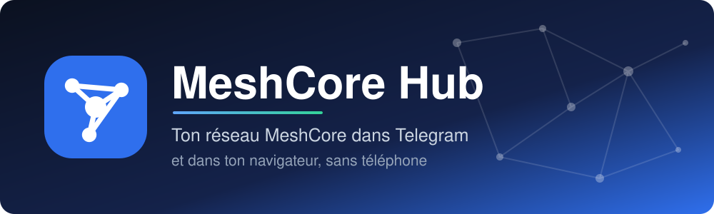
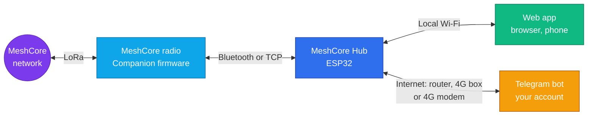
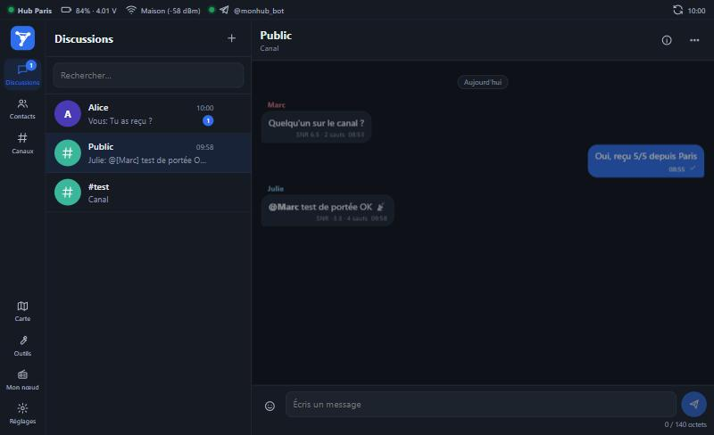
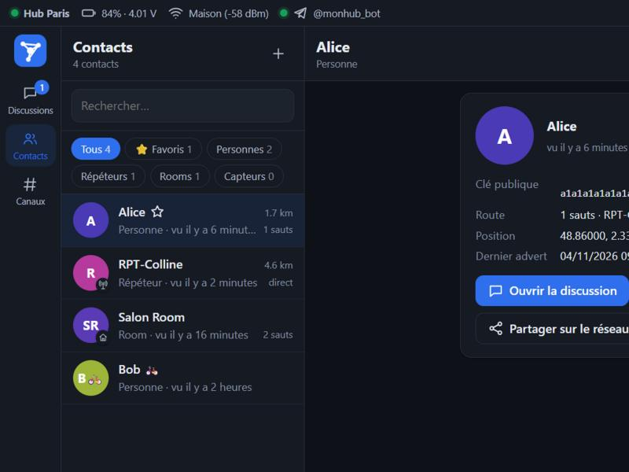
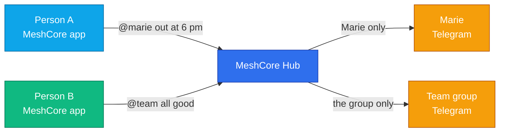

  

  
  
  

<a href="README.md">Français</a> · <b>English</b>

**MeshCore Hub** is an ESP32 firmware that takes the place of the phone next to a [MeshCore](https://github.com/meshcore-dev/MeshCore) radio. Read and answer your mesh messages from **Telegram**, wherever you are, and from a **web app** served by the Hub itself.

No server to rent, no third-party service: an ESP32, a MeshCore radio and your own Telegram bot.

## How it works

## What you get

| | |
|---|---|
| 💬 **Telegram** | One topic per channel and conversation, direct replies, channel creation and removal, delivery feedback. Messages wait in a queue during outages. |
| 🔒 **Private messages** | Each approved contact writes `@marie their message` from their MeshCore app: only Marie receives it on Telegram, and her answer only goes back to its author. Works with a Telegram group too. |
| 🌐 **Web app** | Chats, contacts and favourites, channels with QR sharing, map, tools, radio settings. French and English, installable on your phone. |
| 🖥️ **Status screen** | On the LilyGO T-Display-S3: radio, network, Telegram, latest messages and QR codes. |
| 📶 **Several Wi-Fi networks** | A main network and up to 3 others: the Hub moves from your router to a 4G box on its own, and back. |
| 🗂️ **History** | Messages stored on the board, with automatic rotation. |
| 🧙 **Wizard** | Guided setup, nothing to compile. |

  
  

## Hardware

| Board | Memory | Best for |
|---|---|---|
| ⭐ **LilyGO T-Display-S3** (16 MB flash, 8 MB PSRAM) | Comfortable | **Recommended**: screen, hundreds of contacts, optional 4G modem |

You also need a **MeshCore radio running the Companion firmware**, available from [flasher.meshcore.co.uk](https://flasher.meshcore.co.uk).

> [!IMPORTANT]
> A MeshCore radio accepts **only one Bluetooth connection at a time**. Disconnect your phone before linking the Hub.

## Install in 3 steps

1. Plug the board over USB and open the **[Web Flasher](https://nitrus21.github.io/meshcore-hub/)** in Chrome or Edge on a computer.
2. Join the **MeshCore-Hub-XXXX** Wi-Fi, then open **http://192.168.7.1**. On the T-Display-S3, a QR code on the screen does it for you.
3. Follow the wizard: Wi-Fi, MeshCore radio, Telegram and password.

Later updates are done from the app, in **Settings → Update**, with the files of the [latest release](https://github.com/nitrus21/meshcore-hub/releases/latest). Your history is kept.

## Telegram

1. Create a bot with **[@BotFather](https://t.me/BotFather)** (`/newbot`) and copy its token.
2. Paste the token in the wizard or in **Settings → Telegram**, then send `/start` to your bot. Only linked conversations can control the Hub.
3. For one topic per conversation: in @BotFather open **Bot Settings → Threads Settings**, enable **Threaded Mode**, then choose **Topics** in the Hub.

| Command | Effect |
|---|---|
| `/msg` · `/ch` · `/public` | Write to a contact, a channel, the public channel |
| `/contacts` · `/channels` · `/status` | See contacts, channels, Hub status |
| `/addchannel` · `/delchannel` | Create or remove a channel |
| `/advert` · `/login` · `/mute` | Send an advert, log in to a room, mute a conversation |
| `/help` | All commands |

## Private messages to Telegram

For a team in the field or underground: everyone has a radio, and a single Hub with Internet relays to the right people.

1. In **Settings → Private messages to Telegram**, enable the feature and tick the approved contacts.
2. Name the recipient, then click **Invite a person** or **Invite a group**. Send them the link: it works once, for 24 hours.
3. On the network, send the Hub a private message: `@marie your message`. For several recipients, people or groups: `@marie @team your message`, 5 at most. The message `@?` lists the recipients.
4. Marie uses **Reply** on the message she received: the answer goes back to its author. In a private chat with the bot, a plain message goes to the last person who wrote, unless that chat also controls the Hub. In a group, only replies count. To write first to an approved contact, Marie sends `/msg Paul her message`.

The message comes from the bot, with its author's name. Messages go through the Hub and Telegram in the clear: this is not end-to-end encryption. By default the Hub's history keeps the recipient, not the text.

## Going out without Wi-Fi

- **The easy way:** a pocket 4G router. Add it to the list in **Settings → Wi-Fi**, and place it with the arrows.
- **All in one:** a 4G modem with a SIM card wired to the Hub. See the [4G guide](docs/4G.md) (in French).

## Project status

| | |
|---|---|
| ✅ Tried on hardware | T-Display-S3, Companion radio over Bluetooth, Telegram, web app, screen |
| 🧪 Written, not yet tried in real conditions | Private messages to Telegram, automatic switching between Wi-Fi networks, 4G modem, TCP link |

If you try one of these, your feedback is welcome in the [issues](https://github.com/nitrus21/meshcore-hub/issues).

## Going further

- 📘 [Complete manual for firmware 1.1.7](docs/Manuel-MeshCore-Hub-1.1.7.pdf) (PDF, 61 pages, in French): install, radio, Telegram, web app and every setting
- 📡 [4G modem guide](docs/4G.md) (in French)
- 🛠️ [Building the firmware](docs/BUILD.md) (in French)

## Thanks

Built on [MeshCore](https://github.com/meshcore-dev/MeshCore), [ESP Web Tools](https://github.com/esphome/esp-web-tools), [NimBLE-Arduino](https://github.com/h2zero/NimBLE-Arduino), [ESPAsyncWebServer](https://github.com/ESP32Async/ESPAsyncWebServer), [ArduinoJson](https://arduinojson.org), [LovyanGFX](https://github.com/lovyan03/LovyanGFX), [Leaflet](https://leafletjs.com) and Kazuhiko Arase's QR code generator.

MeshCore Hub is an independent project, not affiliated with the MeshCore team or Telegram.

## Licence

[MIT](LICENSE)
