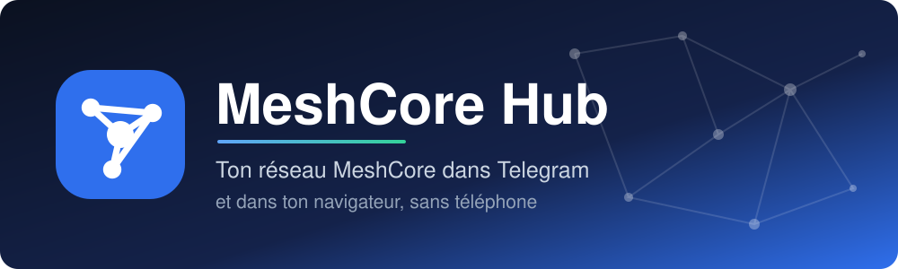
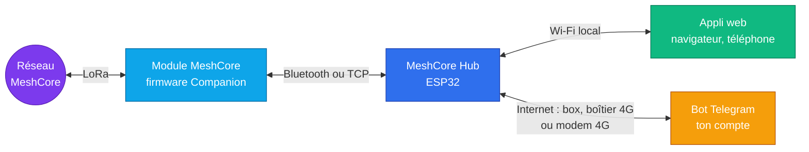
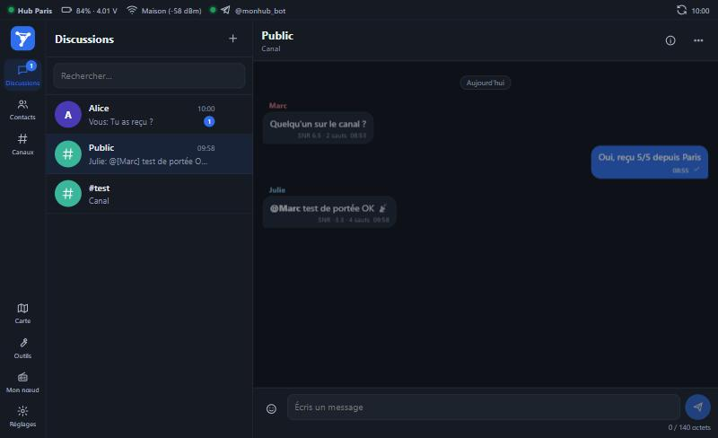
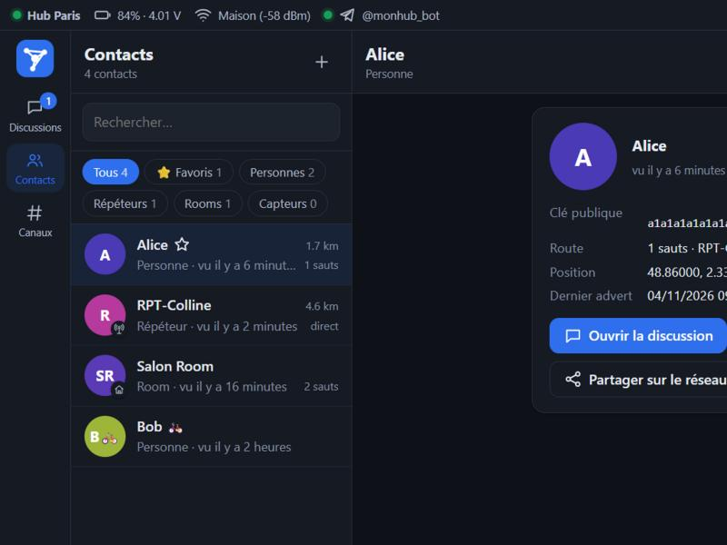
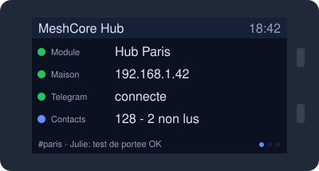
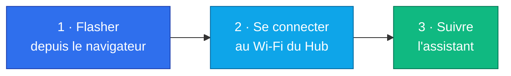
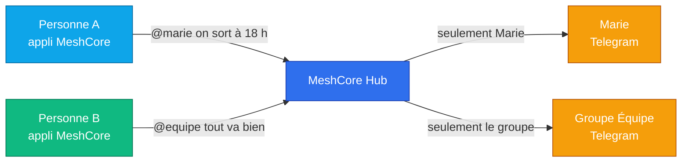

  

  
  
  

<b>Français</b> · <a href="README.en.md">English</a>

**MeshCore Hub** est un firmware pour ESP32 qui prend la place du téléphone auprès d'un module [MeshCore](https://github.com/meshcore-dev/MeshCore). Tu lis et tu réponds aux messages de ton réseau radio depuis **Telegram**, où que tu sois, et depuis une **appli web** servie par le Hub lui-même.

Pas de serveur à louer, pas de service tiers : un ESP32, un module MeshCore et ton propre bot Telegram.

## Comment ça marche

## Ce que tu obtiens

| | |
|---|---|
| 💬 **Telegram** | Un sujet par canal et par conversation, réponse directe, création et suppression de canaux, accusés de réception. Les messages attendent en file pendant les coupures. |
| 🔒 **Messages privés** | Chaque contact autorisé écrit `@marie son message` depuis son appli MeshCore : seule Marie le reçoit sur Telegram, et sa réponse ne revient qu'à l'auteur. Marche aussi avec un groupe Telegram. |
| 🌐 **Appli web** | Discussions, contacts et favoris, canaux avec partage par QR code, carte, outils, réglages du module. En français et en anglais, installable sur le téléphone. |
| 🖥️ **Écran d'état** | Sur la LilyGO T-Display-S3 : module, réseau, Telegram, derniers messages et QR codes. |
| 📶 **Plusieurs Wi-Fi** | Un réseau principal et jusqu'à 3 autres : le Hub passe tout seul de ta box à un boîtier 4G, et revient. |
| 🗂️ **Historique** | Messages conservés sur la carte, avec rotation automatique. |
| 🧙 **Assistant** | Configuration guidée, sans rien compiler ni toucher au code. |

  
  

  

## Matériel

| Carte | Mémoire | Pour qui |
|---|---|---|
| ⭐ **LilyGO T-Display-S3** (16 Mo flash, 8 Mo PSRAM) | Confortable | **Recommandée** : écran, plusieurs centaines de contacts, modem 4G possible |

Il te faut aussi un module **MeshCore avec le firmware Companion**. Il s'installe sur [flasher.meshcore.co.uk](https://flasher.meshcore.co.uk).

> [!IMPORTANT]
> Un module MeshCore n'accepte **qu'une connexion Bluetooth à la fois**. Déconnecte ton téléphone avant de relier le Hub.

## Installation en 3 étapes

1. Branche la carte en USB et ouvre le **[Web Flasher](https://nitrus21.github.io/meshcore-hub/)** dans Chrome ou Edge sur ordinateur.
2. Connecte-toi au Wi-Fi **MeshCore-Hub-XXXX**, puis ouvre **http://192.168.7.1**. Sur la T-Display-S3, un QR code à l'écran le fait pour toi.
3. L'assistant te guide : Wi-Fi, module MeshCore, Telegram et mot de passe.

Les mises à jour se font ensuite depuis l'appli, dans **Réglages → Mise à jour**, avec les fichiers de la [dernière version](https://github.com/nitrus21/meshcore-hub/releases/latest). Ton historique est conservé.

## Telegram

1. Crée un bot avec **[@BotFather](https://t.me/BotFather)** (`/newbot`) et copie son jeton.
2. Colle le jeton dans l'assistant, ou dans **Réglages → Telegram**, puis envoie `/start` à ton bot. Seules les conversations reliées peuvent piloter le Hub.
3. Pour un sujet par conversation : dans @BotFather, ouvre **Bot Settings → Threads Settings** et active **Threaded Mode**, puis choisis **Sujets** dans le Hub.

| Commande | Effet |
|---|---|
| `/msg` · `/ch` · `/public` | Écrire à un contact, à un canal, au canal public |
| `/contacts` · `/canaux` · `/status` | Voir les contacts, les canaux, l'état du Hub |
| `/nouveaucanal` · `/supprcanal` | Créer ou supprimer un canal |
| `/advert` · `/login` · `/sourdine` | S'annoncer, entrer dans une room, couper une conversation |
| `/aide` | Toutes les commandes |

## Messages privés vers Telegram

Pour une équipe sur le terrain ou sous terre : chacun a son module, et un seul Hub relié à Internet relaie vers les bonnes personnes.

1. Dans **Réglages → Messages privés vers Telegram**, active la fonction et coche les contacts autorisés.
2. Donne un nom au destinataire, puis clique sur **Inviter une personne** ou **Inviter un groupe**. Envoie-lui le lien : il est valable 24 heures, une seule fois.
3. Sur le réseau, écris au Hub en message privé : `@marie ton message`. Pour plusieurs destinataires, personnes ou groupes : `@marie @equipe ton message`, 5 au plus. Le message `@?` donne la liste des destinataires.
4. Marie utilise **Répondre** sur le message reçu : la réponse revient à son auteur. Dans une conversation privée avec le bot, un simple message part vers la dernière personne qui a écrit, sauf si cette conversation pilote aussi le Hub. Dans un groupe, seules les réponses comptent. Pour écrire en premier à un contact autorisé, Marie envoie `/msg Paul son message`.

Le message vient du bot, avec le nom de son auteur. Les messages passent en clair par le Hub et par Telegram : ce n'est pas un chiffrement de bout en bout. Par défaut, l'historique du Hub garde le destinataire, pas le texte.

## Sortir sans Wi-Fi

- **Le plus simple :** un boîtier 4G de poche. Ajoute-le dans la liste de **Réglages → Wi-Fi**, et place-le où tu veux avec les flèches.
- **Tout intégré :** un modem 4G avec carte SIM branché sur le Hub. Voir le [guide 4G](docs/4G.md).

## État du projet

| | |
|---|---|
| ✅ Essayé sur matériel | T-Display-S3, module Companion en Bluetooth, Telegram, appli web, écran |
| 🧪 Écrit, pas encore essayé en conditions réelles | Messages privés vers Telegram, bascule automatique entre réseaux Wi-Fi, modem 4G, liaison TCP |

Si tu essaies une de ces fonctions, ton retour est le bienvenu dans les [issues](https://github.com/nitrus21/meshcore-hub/issues).

## Pour aller plus loin

- 📡 [Guide du modem 4G](docs/4G.md)
- 🛠️ [Compiler le firmware soi-même](docs/BUILD.md)

## Remerciements

Ce projet s'appuie sur [MeshCore](https://github.com/meshcore-dev/MeshCore), [ESP Web Tools](https://github.com/esphome/esp-web-tools), [NimBLE-Arduino](https://github.com/h2zero/NimBLE-Arduino), [ESPAsyncWebServer](https://github.com/ESP32Async/ESPAsyncWebServer), [ArduinoJson](https://arduinojson.org), [LovyanGFX](https://github.com/lovyan03/LovyanGFX), [Leaflet](https://leafletjs.com) et le générateur de QR codes de Kazuhiko Arase.

MeshCore Hub est un projet indépendant, sans lien officiel avec l'équipe MeshCore ni avec Telegram.

## Licence

[MIT](LICENSE)
